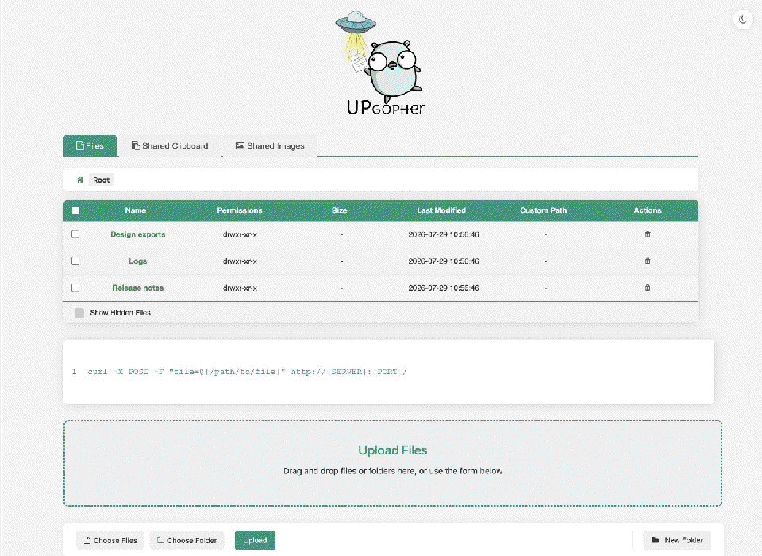

# Upgopher

<p align="center">
  
</p>

<p align="center">
  <strong>A single self-contained binary to share files and clipboard content between devices—no database, dependencies, or mandatory configuration.</strong>
</p>

<p align="center">
  <a href="https://github.com/wanetty/upgopher/actions/workflows/ci.yml"></a>
  <a href="https://github.com/wanetty/upgopher/releases/latest"></a>
  <a href="https://github.com/wanetty/upgopher/blob/main/LICENSE"></a>
  <a href="https://github.com/wanetty/upgopher/pkgs/container/upgopher"></a>
</p>

<p align="center">
  <picture>
    <source media="(prefers-reduced-motion: reduce)" srcset="./docs/assets/file-manager.png">
    
  </picture>
</p>

## Start sharing in three steps

```bash
# 1. Install
go install github.com/wanetty/upgopher@latest

# 2. Share a directory
upgopher -dir ./shared

# 3. Open http://localhost:9090 on this or another device
```

Upgopher binds to all interfaces by default. Use Basic Auth, a trusted local
network, a VPN, or a properly configured reverse proxy before exposing it beyond
your machine.

## Install

| Method | Command |
| --- | --- |
| Homebrew | `brew install --cask wanetty/tap/upgopher` |
| Scoop | `scoop bucket add wanetty https://github.com/wanetty/scoop-bucket` then `scoop install upgopher` |
| Docker | `docker run --rm -p 9090:9090 -v "$PWD:/data" wanetty/upgopher:1.20.0` |
| Go | `go install github.com/wanetty/upgopher@latest` |
| Binary | Download the archive for your OS from [GitHub Releases](https://github.com/wanetty/upgopher/releases/latest) and verify it with `checksums.txt` |

The project-maintained container is also published as
`ghcr.io/wanetty/upgopher`. See the
[installation guide](https://wanetty.github.io/upgopher/getting-started.html)
for platform-specific instructions and persistent Docker examples.

## What it is good at

- **Move files across a LAN.** Open a browser on a phone, laptop, VM, or lab
  machine and upload or download without setting up a client.
- **Share text and screenshots between devices.** The built-in shared clipboard
  supports multiple tabs and optional per-tab protection.
- **Expose a development folder temporarily.** Serve build output, logs, or test
  artifacts with one command.
- **Publish a read-only download portal.** Keep browsing and downloads available
  while disabling uploads and deletion with `-readonly`.
- **Run a small homelab file drop.** Put Upgopher behind your VPN, tunnel, or
  reverse proxy when you need a compact browser-based tool instead of a storage
  platform.

## Included

**Files:** drag-and-drop file and folder uploads, download, directory creation
and deletion, ZIP downloads, search inside text files, breadcrumbs, and a
directory tree.

**Sharing:** copyable direct links, custom path aliases, and a shared clipboard
for text and screenshots.

**Controls:** optional Basic Auth, built-in HTTPS with a self-signed or custom
certificate, read-only mode, hidden-file controls, upload limits, and server
timeouts.

Everything required by the UI is embedded in the binary. Upgopher uses only the
Go standard library and does not require a database or configuration file.

## Choosing the right tool

Comparison checked for Upgopher v1.20.0 in July 2026. Projects evolve; follow
the linked sources for their current feature sets.

| Tool | Artifact / runtime | Upload and management | Auth model | Users / roles | HTTPS | WebDAV | Resumable uploads | Shared clipboard | Best fit |
| --- | --- | --- | --- | --- | --- | --- | --- | --- | --- |
| **Upgopher** | Self-contained Go binary | Browser file manager | Optional global Basic Auth | No | Built in | No | No | Text and screenshots | The smallest step from a folder to a practical browser sharing UI |
| [`python -m http.server`](https://docs.python.org/3/library/http.server.html) | Python runtime | Browse and download | No built-in access control | No | CLI TLS options in current Python | No | No | No | Temporary, read-only serving during local development |
| [Dufs](https://github.com/sigoden/dufs) | Single Rust binary | Upload, edit, search, archive | Access controls | Account rules | Built in | Yes | Yes | No | A compact server when WebDAV or resumable transfers matter |
| [File Browser](https://filebrowser.org/) | Binary or container with persistent state | Full web file administration | Login and persistent auth | Yes | Commonly via proxy | No | No | No | Multi-user file management with administration and permissions |
| [Copyparty](https://github.com/9001/copyparty) | Python runtime or self-extracting bundle | Extensive file and media features | Accounts and per-volume permissions | Yes | Built in | Yes | Yes | No | Advanced transfers, protocols, indexing, deduplication, and media workflows |

Upgopher deliberately does **not** provide WebDAV, resumable uploads,
multi-user roles, storage backends, or a persistent administration database. If
one of those is central to your setup, one of the alternatives above is likely
a better choice.

## Common commands

```bash
# Protect access
upgopher -dir ./shared -user admin -pass 'choose-a-strong-password'

# Download-only portal
upgopher -dir ./public -readonly

# Built-in HTTPS with an ephemeral self-signed certificate
upgopher -dir ./shared -ssl

# Encrypt file content before it crosses an HTTPS tunnel
upgopher -dir ./shared -encrypt-transfers -user admin -pass 'choose-a-strong-password'
# In another terminal: cloudflared tunnel --url http://localhost:9090

# Custom port and a 1 GiB upload limit
upgopher -dir ./shared -port 8080 -max-upload-size 1
```

Read the full [configuration reference](https://wanetty.github.io/upgopher/configuration.html).

## Security and limits

- Treat an unauthenticated instance as public to every device that can reach
  its port.
- Prefer a VPN or a reverse proxy with trusted TLS for internet-facing use.
- `-ssl` without `-cert` and `-key` creates a new self-signed certificate at
  startup; clients will not trust it automatically.
- `-encrypt-transfers` adds browser-to-server application encryption to uploads,
  downloads, ZIPs, file previews/search results, and shared images. It requires
  HTTPS or localhost. The server stores normal, decrypted files; names, paths,
  sizes, and transfer timing remain observable. Clipboard text is outside its scope.
- Transfer encryption protects against **passive** tunnel observers. A provider
  that modifies the delivered HTML/JavaScript can steal files or keys; the
  fingerprint shown by that page does not fix this trust boundary. This mode
  is not a guarantee against an active intermediary, including one that
  reuses observed access credentials to act as another authorized client.
- Encrypted shared links open a browser download page. Direct file embedding,
  plain multipart clients such as `curl -F`, and native plaintext downloads are
  unavailable in this mode. Without the flag, existing behavior is preserved.
- Downloads use direct disk writing when supported. Otherwise encrypted
  downloads are limited to 256 MiB per operation, including ZIPs. Requests are
  staged in a private temporary directory; allow disk space for an upload copy
  and encrypted response copies. Interrupted transfers expire after 15 minutes;
  ordinary shutdown cleans staging files. A forced kill can leave temporary files.
- Basic Auth is global. Upgopher does not provide separate user accounts or
  per-folder permissions.
- Clipboard data and custom path aliases are held in memory and disappear when
  the process restarts.
- A read-only instance prevents uploads and deletion through Upgopher; it does
  not change host filesystem permissions.

See the [security guide](https://wanetty.github.io/upgopher/security.html).
Report vulnerabilities privately to [@gm_eduard](https://twitter.com/gm_eduard);
do not open a public issue.

## Documentation

- [Website and overview](https://wanetty.github.io/upgopher/)
- [Getting started](https://wanetty.github.io/upgopher/getting-started.html)
- [Configuration reference](https://wanetty.github.io/upgopher/configuration.html)
- [Security](https://wanetty.github.io/upgopher/security.html)
- [Troubleshooting](https://wanetty.github.io/upgopher/troubleshooting.html)
- [Contributing](./CONTRIBUTING.md)

Upgopher is available under the [MIT License](./LICENSE).
